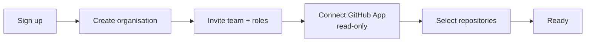
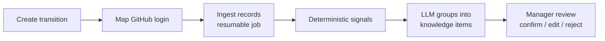

# Exit Brain — Product Requirements Document (PRD)

> Version 0.1 · Owner: Mani · Status: Draft for MVP

## 1. Executive summary

**Problem.** When a key engineer leaves, undocumented knowledge (recurring tasks, workarounds, client-specific rules, failure scenarios) is lost. Successors take months to reach full productivity and production incidents happen in the gap. Existing exit tools mostly **ask the leaving person** what they know; people cannot list what they don't realise only they know.

**Solution.** Exit Brain analyses **authorised work records** (GitHub in the MVP) to detect knowledge concentrated in one person, runs an **evidence-based interview**, **verifies** answers against records, produces a **human-approved handover document**, and gives the successor a **cited knowledge assistant**.

**Initial market.** Software companies, development agencies and startups with 10–200 engineers.

**Differentiator.** "Evidence first, then ask" — every question and every handover claim links to the work record that motivated it, with a confidence level and verification status. AI suggests; humans approve.

**MVP goal.** In 7 days, a working demo of the full journey on real GitHub data: connect → analyse → interview → verify → handover → successor search.

## 2. Goals and non-goals

| Goals (MVP) | Non-goals (MVP) |
|---|---|
| Complete, working end-to-end journey for one transition | Production-grade enterprise readiness |
| Real GitHub ingestion via read-only GitHub App | Real Slack, Jira, Drive, CRM ingestion |
| Evidence citations, confidence, verification status everywhere | Fully autonomous agent decisions |
| Human approval at every sensitive step | Any employment or performance decisions |
| Tenant isolation enforced in the database (RLS) | SSO/SAML, SCIM, billing |
| Usable by a non-technical HR user | Mobile apps |

## 3. Target customers and personas

### 3.1 Ideal initial customer profile (ICP) — [RECOMMENDATION]

- **Company:** software product company or development agency, **20–150 people**, 10–80 engineers, code on **GitHub**, team chat on Slack.
- **Situation:** a senior engineer, tech lead or long-tenured developer has resigned (notice period 2–8 weeks), or a founder/CTO worries about "bus factor".
- **Why them first:** their knowledge lives in GitHub (machine-readable), decisions are fast (CTO/EM can buy), and pain is concrete (incidents, delayed client work).

### 3.2 Buyer, users, triggers

| Role | Type | Pain | Buying trigger |
|---|---|---|---|
| **CTO / VP Eng / Agency owner** | Economic buyer | Delivery risk, incidents, client churn when people leave | A senior resignation; a near-miss incident; client escalation |
| **Engineering Manager / Team Lead** | Champion + daily user | Has to organise handover while still delivering | Resignation lands on their team |
| **HR / People Ops** | Secondary buyer, user | Exit process is a checklist without knowledge capture | Policy push to "retain knowledge" |
| **Leaving employee** | User | Wants a clean exit, limited time | Asked by manager |
| **Successor** | User | Inherits systems with no context | Starts owning the area |

### 3.3 Personas

**Priya — Engineering Manager (champion).** Runs an 8-person backend team at a 60-person SaaS company. Ravi, her most senior engineer, resigned with 30 days' notice. She needs a reliable handover without spending 20 hours writing it herself. *Success for Priya:* a reviewed handover document and confidence that nothing critical was missed.

**Ravi — Leaving senior engineer.** Five years at the company, owns billing integrations. Wants to leave on good terms but is busy with final tasks. *Success for Ravi:* short, specific questions (15 min/day), able to correct the AI, see exactly what will be shared.

**Kiran — Successor.** Two years' experience, takes over billing. *Success for Kiran:* a prioritised checklist and a place to ask "how did Ravi handle X?" with answers he can trust (citations).

**Anita — HR Business Partner.** Non-technical. *Success for Anita:* see transition status and completion % without reading code.

**Arjun — Agency owner / CTO (buyer).** Cares about price, security and client confidentiality. *Success for Arjun:* read-only access, clear data retention, a client never suffers from a departure.

### 3.4 Willingness-to-pay assumptions — [ASSUMPTION]

- Replacing a senior engineer costs far more than $1,000 in recruiting + ramp-up; a handover tool priced **$299 per departure** is a small, easy decision. To be validated (see `09-business/go-to-market.md`).
- Buyers prefer **per-handover** pricing first (event-driven), then a subscription for continuous risk monitoring.

## 4. User stories (MVP)

Priority: **P0** = required for demo, **P1** = should have, **P2** = nice to have.

### Onboarding & admin
| ID | Story | Pri |
|---|---|---|
| US-01 | As an admin, I can sign up and create an organisation workspace. | P0 |
| US-02 | As an admin, I can invite users by email and assign roles (admin, manager, employee, successor, viewer). | P0 |
| US-03 | As an admin, I can connect GitHub through a read-only GitHub App and choose which repositories Exit Brain may read. | P0 |
| US-04 | As an admin, I can disconnect an integration and request deletion of its ingested data. | P1 |
| US-05 | As an admin, I can view an audit log of who accessed or changed what. | P1 |

### Transition & analysis
| ID | Story | Pri |
|---|---|---|
| US-10 | As a manager, I can start a transition for an employee, set last working day and successor. | P0 |
| US-11 | As a manager, I can map the employee to their GitHub username. | P0 |
| US-12 | As a manager, I see ingestion progress and errors. | P0 |
| US-13 | As a manager, I see detected knowledge areas, each with evidence links, risk level and confidence. | P0 |
| US-14 | As a manager, I can confirm, edit or reject each detected knowledge area. | P0 |

### Interview
| ID | Story | Pri |
|---|---|---|
| US-20 | As a leaving employee, I see personalised questions with the evidence that prompted them. | P0 |
| US-21 | As a leaving employee, I answer in chat; the system asks a follow-up if my answer is vague or incomplete. | P0 |
| US-22 | As a leaving employee, I can review, edit and approve my answers before they are shared. | P0 |
| US-23 | As a leaving employee, I can mark a question "not applicable" or "ask someone else" with a reason. | P1 |

### Verification & handover
| ID | Story | Pri |
|---|---|---|
| US-30 | As a manager, I see each answer's verification status and the evidence behind it. | P0 |
| US-31 | As a manager, I can generate a handover document, edit it, and approve it. | P0 |
| US-32 | As a manager, I can export the approved handover as Markdown and printable PDF. | P1 |

### Successor
| ID | Story | Pri |
|---|---|---|
| US-40 | As a successor, I see a prioritised learning checklist and can mark items done. | P0 |
| US-41 | As a successor, I can ask questions and get answers only from approved knowledge, with citations. | P0 |
| US-42 | As a successor, when the assistant cannot answer, I can escalate the question to the employee (if still present) or manager. | P1 |

### Dashboard
| ID | Story | Pri |
|---|---|---|
| US-50 | As a manager/HR, I see all transitions with status, completion %, unverified items and open risks. | P0 |
| US-51 | As a manager, I see a knowledge-concentration risk score for an employee with explanation. | P1 |

## 5. Functional requirements

| ID | Requirement | Stories |
|---|---|---|
| FR-01 | Email/password and magic-link auth via Supabase Auth. | US-01 |
| FR-02 | Organisation created on first signup; creator becomes `owner`. | US-01 |
| FR-03 | Invitations by email with role; accepting links user to org. | US-02 |
| FR-04 | Roles: `owner`, `admin`, `manager`, `employee`, `successor`, `viewer`. Permissions per `07-security`. | US-02 |
| FR-05 | GitHub App install flow; store `installation_id`; list accessible repos; admin selects subset. | US-03 |
| FR-06 | Disconnect integration: mark revoked, stop jobs, offer data deletion. | US-04 |
| FR-07 | Transition record: employee, successor, last day, status lifecycle (`draft → ingesting → analysing → interviewing → verifying → handover_review → completed`, or `cancelled`). | US-10 |
| FR-08 | Ingest for the mapped GitHub login within selected repos and a time window (default 18 months): commits (with changed file paths), PRs (title/body/review comments count), issues (authored/assigned). Store excerpts, not full files. | US-12 |
| FR-09 | Ingestion is resumable, rate-limit aware, idempotent (unique `source + external_id`). | US-12 |
| FR-10 | Compute deterministic signals per path/area: author share, recency, solo-ownership, change frequency, recurring patterns (e.g., commits on same weekday/day-of-month). | US-13 |
| FR-11 | LLM groups signals + evidence into **knowledge items** (category, summary, risk, confidence) each linked to ≥1 evidence record. Items without evidence are rejected by the system. | US-13 |
| FR-12 | Manager review: confirm / edit / reject each item; decision logged. | US-14 |
| FR-13 | Generate 3–6 questions per confirmed high/medium item, each referencing evidence. | US-20 |
| FR-14 | Interview chat; answer classified as `complete / vague / incomplete / off-topic`; up to 2 follow-ups per question. | US-21 |
| FR-15 | Employee approval required before answers appear in handover or assistant. | US-22 |
| FR-16 | Verification per approved answer: `supported / partially_supported / conflicting / unverified` with explanation and evidence links. | US-30 |
| FR-17 | Handover document generated from confirmed items + approved answers only; sections per §7 Workflow E; every claim carries citation + status. | US-31 |
| FR-18 | Handover versioning; only an `approved` version is visible to the successor. | US-31 |
| FR-19 | Export approved handover to Markdown; print-friendly HTML → PDF via browser. | US-32 |
| FR-20 | Successor checklist auto-created from items, ordered by risk; status tracking. | US-40 |
| FR-21 | Assistant: retrieve from approved answers, confirmed items and approved handover (Postgres full-text search in MVP); answer with citations; respond "not found in approved knowledge" when retrieval is weak. | US-41 |
| FR-22 | Unanswered questions can be escalated, creating a new interview question or manager task. | US-42 |
| FR-23 | Dashboard metrics per §7 Workflow G, computed from DB (no AI). | US-50 |
| FR-24 | Risk score per employee (single-employee, MVP): transparent formula, factors shown. | US-51 |
| FR-25 | Audit log entries for: login, integration connect/disconnect, ingestion, item review, answer approval, handover approval, export, data deletion, role changes. | US-05 |
| FR-26 | All demo/mock data visibly labelled **"MOCK DATA"** in UI and flagged `is_mock = true` in DB. | — |

## 6. Non-functional requirements

| ID | Category | Requirement |
|---|---|---|
| NFR-01 | Security | Tenant isolation enforced by Postgres RLS on every tenant table; verified by automated cross-tenant tests. |
| NFR-02 | Security | Integrations read-only; least-privilege scopes (GitHub: Metadata, Contents, Pull requests, Issues — all **read**). |
| NFR-03 | Security | Secrets (GitHub App private key, LLM keys) only in Supabase Edge Function secrets / Vault; never in frontend or repo. |
| NFR-04 | Privacy | Store excerpts (commit messages, PR titles/bodies truncated, file paths), not full source code. Configurable retention (default: 90 days after transition completion). |
| NFR-05 | AI safety | No AI output is shown as fact without evidence; all AI content labelled; human approval gates (item review, answer approval, handover approval). |
| NFR-06 | AI safety | Agent has no write access to any customer system; no employment decisions; no evaluation of employee performance. |
| NFR-07 | Reliability | Jobs resumable after failure; retries with exponential backoff; max attempts then `failed` with visible error. |
| NFR-08 | Performance (targets, not measured) | Dashboard pages load < 2 s with 1,000 evidence records; analysis of 500 evidence records completes < 10 min. To be measured in Day 7. |
| NFR-09 | Usability | Non-technical HR can follow transition status without reading code; WCAG 2.1 AA colour contrast and keyboard navigation for main flows. |
| NFR-10 | Observability | Structured logs for jobs and AI runs (model, prompt version, tokens, latency, status). |
| NFR-11 | Portability | LLM provider behind an interface; switching provider needs config change + adapter, not app rewrite. |
| NFR-12 | Cost | Track tokens per transition; target LLM cost per handover < $5 (assumption, to be measured). |

## 7. End-to-end workflows

### Workflow A — Company onboarding

1. Admin signs up (Supabase Auth) → org created, admin = `owner` (audit: `org.created`).
2. Org profile: name, size band, timezone, data-retention days (default 90).
3. Invite users with roles; invite token emailed; acceptance creates membership.
4. Integrations page → "Connect GitHub" → GitHub App install page → customer chooses org + repos → callback with `installation_id` → Exit Brain verifies installation belongs to the GitHub account the user authorised → stores connection.
5. Admin selects repos Exit Brain may read (subset of installed repos). Only selected repos are ever queried.

**Errors:** callback state mismatch → reject; installation with zero repos → prompt to add; installation suspended/removed (webhook) → mark `revoked`.

### Workflow B — Employee knowledge-risk analysis

1. Manager creates transition (employee, successor, last day) and maps GitHub login.
2. Ingestion job: for each selected repo → commits by author (since window), PRs by author, issues authored/assigned → `evidence_records`.
3. Signals computed (SQL + TypeScript, deterministic): per top-level path/module — author share, last touch, # other contributors in 12 months, recurring timing patterns, keywords (`hotfix`, `workaround`, `TODO`, `temporary`, `cron`, `migration`).
4. LLM receives compact signal summary + top evidence excerpts → returns knowledge items (JSON validated by schema), each citing evidence IDs. Items citing unknown IDs are dropped.
5. Confidence: `high` (strong signal + multiple evidence), `medium`, `low` (single weak evidence). Risk: from deterministic score bands.
6. Manager reviews; only `confirmed`/`edited` items proceed.

### Workflow C — Intelligent knowledge interview

1. For each confirmed item (high risk first), generate 3–6 questions; each shows its evidence ("Why are we asking?").
2. Employee answers in chat. Answer assessor labels it; if `vague`/`incomplete` → up to 2 follow-ups.
3. Employee can skip with reason or reassign to another person (P1).
4. Employee reviews a summary of their answers per item, edits, then **approves**. Unapproved answers are never shown to successors.

### Workflow D — Knowledge verification

1. For each approved answer, retrieve related evidence (same item + full-text match).
2. LLM compares claim vs evidence → status + explanation + evidence IDs.
3. Rules: no matching evidence → `unverified` (not "false"); contradiction → `conflicting` and a manager task is created.
4. Manager can override status with a comment (logged as review decision).

### Workflow E — Handover documentation

Sections (generated only from confirmed items + approved answers):

1. Summary of role and transition (dates, successor)
2. Systems and services maintained
3. Recurring operational tasks (what, when, how, what if missed)
4. Deployment and troubleshooting procedures
5. Dependencies and known failure scenarios
6. Clients and project responsibilities (only if present in approved answers)
7. Escalation contacts and ownership
8. Outstanding work and unresolved issues
9. Open questions / unverified items
10. Evidence appendix

Each statement shows: citation(s), confidence, verification status. Manager edits → approves (version locked). Export Markdown / print PDF.

### Workflow F — Successor onboarding

1. Successor assigned → checklist created from confirmed items (high risk first).
2. Each checklist item links to handover section + evidence.
3. Assistant: retrieves from approved sources only → answer with citations, or "I can't find this in approved knowledge" + "Escalate".
4. Readiness % = completed checklist items / total (weighted by risk).

### Workflow G — Manager dashboard

Per transition: status, days to last day, % items reviewed, % questions answered, % answers approved, # unverified/conflicting, handover status, successor readiness %, open escalations. All computed by SQL views — no AI.

### Workflow H — Security & administration

RBAC per role matrix (`07-security`), read-only integrations, audit log viewer, disconnect + data deletion, retention job deleting evidence and AI artefacts N days after completion, export of audit log (P2).

## 8. Success metrics (MVP demo + pilot) — [ASSUMPTION] targets

| Metric | Target for pilot |
|---|---|
| End-to-end demo runs without manual DB edits | Yes |
| % of AI knowledge items manager confirms (precision proxy) | ≥ 60% |
| % of handover statements with ≥1 citation | 100% |
| Employee time spent in interview | ≤ 2 hours total |
| Successor rates handover "useful" | ≥ 4/5 |
| Pilot customers willing to pay after trial | ≥ 1 of 3 |

These are goals to measure, not claimed results.
