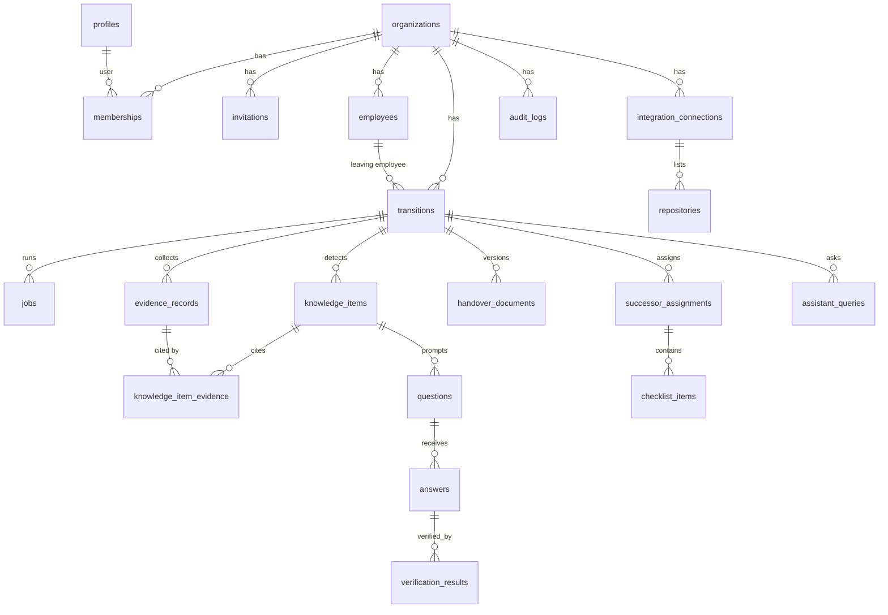

# Exit Brain — Database Schema & Relationships

> Version 0.2 · 15 Oct 2026 · Status: Day 1 tables implemented (`supabase/migrations/20261015000001_core.sql`, `…02_profile_trigger.sql`), 44 pgTAP tests passing
> Source docs: `01-product/PRD.md`, `05-plan/7-day-roadmap.md`, `07-security/security-and-privacy.md`
> Labels: **[FACT] [ASSUMPTION] [RECOMMENDATION] [RESEARCH NEEDED]** — see README §4.

## 1. Design principles

| # | Principle | Label |
|---|---|---|
| P1 | Every tenant table has `org_id uuid not null references organizations(id) on delete cascade` and **RLS enabled**. No exceptions. | [RECOMMENDATION] (non-negotiable project rule) |
| P2 | RLS policies use helper functions (`private.is_member`, `private.has_role`, `private.can_access_transition`, `private.shares_org_with`) that are `security definer`, `stable`, with `set search_path = ''`, to avoid recursive RLS on `memberships`. They live in schema **`private`**, which the Data API does not expose; `execute` granted to `authenticated` only (policies need it). | [RECOMMENDATION] (changed Day 1: was `public`) |
| P3 | Supabase `service_role` key **bypasses RLS**. It is used only inside Edge Functions for: org creation, invite acceptance, audit inserts, job runner. All other Edge Functions query with the **caller's JWT** so RLS still applies. | [FACT] bypass behaviour — [Supabase RLS docs](https://supabase.com/docs/guides/database/postgres/row-level-security); usage rule = [RECOMMENDATION] |
| P4 | Primary keys `uuid default gen_random_uuid()`; timestamps `timestamptz default now()`. `audit_logs` uses `bigint generated always as identity` (high volume, ordered). | [RECOMMENDATION] |
| P5 | Store **excerpts, not source code** (NFR-04). Evidence excerpts truncated (commit message ≤ 2,000 chars, PR/issue body ≤ 4,000 chars). | [RECOMMENDATION] — limits are [ASSUMPTION], tune on Day 2 |
| P6 | Mock rows carry `is_mock boolean not null default false` on `evidence_records` (FR-26). UI shows **MOCK DATA** when true. | [RECOMMENDATION] |
| P7 | Views exposed to clients are created `with (security_invoker = true)` so the caller's RLS applies (Postgres 15+). | [FACT] Postgres 15 feature; [RESEARCH NEEDED] confirm Postgres version of your Supabase project on Day 1 (`select version();`) |
| P8 | Every foreign key column and every `org_id` is indexed (RLS filters on `org_id` on every query). | [RECOMMENDATION] |

## 2. Enums

```sql
create type public.org_role          as enum ('owner','admin','manager','employee','successor','viewer');
create type public.transition_status as enum ('draft','ingesting','analysing','interviewing','verifying','handover_review','completed','cancelled');
-- Day 2+
create type public.integration_status as enum ('active','suspended','revoked');
create type public.job_status        as enum ('queued','running','succeeded','failed','cancelled');
create type public.evidence_source   as enum ('github_commit','github_pr','github_issue','slack_message'); -- slack_message: mock only in MVP
-- Day 3+
create type public.item_category     as enum ('system','recurring_task','deployment','troubleshooting','dependency','client','other');
create type public.level             as enum ('high','medium','low');          -- used for risk and confidence
create type public.item_status       as enum ('suggested','confirmed','edited','rejected');
-- Day 4+
create type public.answer_class      as enum ('complete','vague','incomplete','off_topic');
create type public.answer_status     as enum ('draft','approved','skipped','reassigned');
-- Day 5+
create type public.verification_status as enum ('supported','partially_supported','conflicting','unverified');
create type public.handover_status   as enum ('draft','in_review','approved','superseded');
create type public.checklist_status  as enum ('todo','in_progress','done');
```

## 3. Entity-relationship overview



## 4. Day 1 tables (migration `0001_core.sql`) — full spec

### 4.1 `organizations`
| Column | Type | Notes |
|---|---|---|
| id | uuid PK | |
| name | text not null | 2–100 chars (check) |
| size_band | text | `'1-20' | '21-50' | '51-150' | '151+'` (check) |
| timezone | text not null default `'Asia/Kolkata'` | IANA name |
| retention_days | int not null default 90 | check 30–365 (NFR-04) |
| created_by | uuid not null → `auth.users(id)` | |
| created_at | timestamptz | |

Not a "child" table, so it has no `org_id`; its own `id` is the tenant key.

### 4.2 `profiles` (1:1 with `auth.users`)
| Column | Type | Notes |
|---|---|---|
| id | uuid PK → `auth.users(id) on delete cascade` | |
| full_name | text | |
| email | text not null | copied on signup |
| created_at | timestamptz | |

Created by trigger on `auth.users` insert (`0002_profile_trigger.sql`). Not tenant-scoped (a user can be in several orgs); RLS limits visibility to self + people sharing an org.

### 4.3 `memberships`
| Column | Type | Notes |
|---|---|---|
| id | uuid PK | |
| org_id | uuid not null → organizations | indexed |
| user_id | uuid not null → profiles | indexed |
| role | org_role not null | |
| created_at | timestamptz | |
| | **unique (org_id, user_id)** | one role per user per org (MVP) |

Trigger `prevent_last_owner_loss`: blocks update/delete that would leave an org with zero `owner`.

### 4.4 `invitations`
| Column | Type | Notes |
|---|---|---|
| id | uuid PK | |
| org_id | uuid not null | |
| email | text not null | lower-cased (check `email = lower(email)`) |
| role | org_role not null | check `role <> 'owner'` |
| token_hash | text not null unique | **SHA-256 of token**; raw token only in email/link, never stored |
| invited_by | uuid not null → profiles | |
| expires_at | timestamptz not null | default now() + 7 days |
| accepted_at | timestamptz | null until accepted |
| revoked_at | timestamptz | |
| created_at | timestamptz | |

Partial unique index: `(org_id, email) where accepted_at is null and revoked_at is null` (one open invite per email).

### 4.5 `employees`
Separate from `profiles`: the leaving employee is tracked **before** (or without) having a login.

| Column | Type | Notes |
|---|---|---|
| id | uuid PK | |
| org_id | uuid not null | |
| full_name | text not null | |
| email | text | |
| github_login | text | mapped by manager (US-11); `unique (org_id, lower(github_login))` |
| user_id | uuid → profiles | set when the employee accepts an `employee` invite (Day 4) |
| created_at | timestamptz | |

### 4.6 `transitions`
| Column | Type | Notes |
|---|---|---|
| id | uuid PK | |
| org_id | uuid not null | |
| employee_id | uuid not null → employees | |
| successor_user_id | uuid → profiles | nullable until chosen |
| last_working_day | date not null | |
| status | transition_status not null default `'draft'` | lifecycle per FR-07 |
| window_months | int not null default 18 | ingestion window (FR-08) |
| created_by | uuid not null → profiles | |
| created_at / updated_at | timestamptz | `updated_at` via trigger |

Partial unique index: one **active** transition per employee: `(employee_id) where status not in ('completed','cancelled')`.
Status transitions enforced in Edge Functions (not by clients); clients cannot update `status` directly (see §6).

### 4.7 `audit_logs` (append-only)
| Column | Type | Notes |
|---|---|---|
| id | bigint identity PK | |
| org_id | uuid not null | |
| actor_user_id | uuid | null for system jobs |
| action | text not null | e.g. `org.created`, `member.invited`, `integration.connected` (list in security doc §5.7) |
| target_type | text | `transition`, `knowledge_item`, … |
| target_id | text | |
| metadata | jsonb not null default `'{}'` | **never** secrets or raw tokens |
| created_at | timestamptz | |

`revoke update, delete on audit_logs from authenticated, anon;` Inserts only through the `_shared/audit.ts` helper (service role).

## 5. Helper functions & RPCs (Day 1)

> **Day 1 change:** helpers moved to schema `private` (code below shows the original `public.` names; the migration is authoritative). Multi-row writes are SECURITY DEFINER RPCs called with the **user's JWT**, so Edge Functions don't need the service role for them:
> - `public.create_organization(name, size_band, timezone)` → inserts org + owner membership + `org.created` audit atomically (FR-02).
> - `public.accept_invitation(raw_token)` → hashes token, checks unused / unexpired / unrevoked / email matches the caller, creates membership, audits `member.joined` (FR-03, T11). Every failure returns the same `invalid invitation` error.
> - There is **no client-callable audit writer**: a `log_audit()` RPC was drafted and removed because any member could forge events. Audit rows come only from these RPCs and from Edge Functions via `_shared/audit.ts` (service role).
> - Extra integrity trigger `private.check_transition_same_org`: a transition's employee and successor must belong to the same org; it refuses non-writers first so it can't be used to probe another org's membership.
> - Migration files use Supabase CLI timestamp names (`20261015000001_core.sql`), not `0001_core.sql`.


```sql
-- Is the current user a member of this org?
create or replace function public.is_member(p_org uuid)
returns boolean language sql stable security definer set search_path = '' as $$
  select exists (
    select 1 from public.memberships m
    where m.org_id = p_org and m.user_id = (select auth.uid())
  );
$$;

-- Does the current user hold one of these roles in this org?
create or replace function public.has_role(p_org uuid, p_roles public.org_role[])
returns boolean language sql stable security definer set search_path = '' as $$
  select exists (
    select 1 from public.memberships m
    where m.org_id = p_org and m.user_id = (select auth.uid()) and m.role = any (p_roles)
  );
$$;

-- Can the current user see this transition? (staff of the org, the leaving employee, or the successor)
create or replace function public.can_access_transition(p_transition uuid)
returns boolean language sql stable security definer set search_path = '' as $$
  select exists (
    select 1 from public.transitions t
    left join public.employees e on e.id = t.employee_id
    where t.id = p_transition
      and (
        public.has_role(t.org_id, array['owner','admin','manager']::public.org_role[])
        or e.user_id = (select auth.uid())
        or t.successor_user_id = (select auth.uid())
      )
  );
$$;

revoke execute on function public.is_member(uuid), public.has_role(uuid, public.org_role[]),
  public.can_access_transition(uuid) from public, anon;
grant execute on function public.is_member(uuid), public.has_role(uuid, public.org_role[]),
  public.can_access_transition(uuid) to authenticated;
```

[RECOMMENDATION] `(select auth.uid())` wrapped in a sub-select so Postgres evaluates it once per statement instead of per row.

## 6. Day 1 RLS policies

Legend: **S**elect / **I**nsert / **U**pdate / **D**elete. "SR only" = no client policy; only Edge Functions with service role.

| Table | S | I | U | D |
|---|---|---|---|---|
| organizations | `is_member(id)` | SR only (`api-create-org`) | `has_role(id, {owner,admin})` | none |
| profiles | `id = auth.uid()` or shares an org with caller | SR only (trigger) | `id = auth.uid()` | none |
| memberships | `is_member(org_id)` | SR only (`api-create-org`, `api-accept-invite`) | `has_role(org_id,{owner,admin})` + last-owner trigger | `has_role(org_id,{owner,admin})` + last-owner trigger |
| invitations | `has_role(org_id,{owner,admin})` | `has_role(org_id,{owner,admin})` and `invited_by = auth.uid()` | `has_role(org_id,{owner,admin})` (revoke only) | none |
| employees | `has_role(org_id,{owner,admin,manager,viewer})` or `user_id = auth.uid()` | `has_role(org_id,{owner,admin,manager})` | `has_role(org_id,{owner,admin,manager})` | none |
| transitions | `can_access_transition(id)` or `has_role(org_id,{viewer})` | `has_role(org_id,{owner,admin,manager})` and `status = 'draft'` | `has_role(org_id,{owner,admin,manager})`; column grant excludes `status` | none (use `cancelled`) |
| audit_logs | `has_role(org_id,{owner,admin})` | SR only | never | never |

Column-level: `revoke update (status) on transitions from authenticated;` — status moves only via Edge Functions.

[ASSUMPTION] In the MVP a `manager` sees **all** transitions in the org. Team-scoped managers are deferred.

## 7. Day 2–6 tables (spec level; full DDL written on that day)

Every table below: `org_id` + RLS + `org_id` index. Default read policy = `can_access_transition(transition_id)` unless stated.

| Day | Table | Key columns | Key constraints / policy notes |
|---|---|---|---|
| 2 | `integration_connections` | provider (`github`), installation_id bigint, account_login, status integration_status, connected_by | unique (org_id, provider, installation_id); S/I/U owner+admin only; **no secrets stored** (tokens minted per request) |
| 2 | `repositories` | connection_id, github_repo_id bigint, full_name, is_selected bool | unique (connection_id, github_repo_id); only `is_selected` repos ever queried |
| 2 | `jobs` | transition_id, type (`ingest_github`,`analyse`,`verify`,`generate_handover`,`retention_cleanup`), status job_status, cursor jsonb, attempts int, max_attempts int default 5, next_run_at, last_error text, locked_until | client S only (staff); all writes SR (job-runner); index (status, next_run_at) |
| 2 | `evidence_records` | transition_id, source evidence_source, external_id text, repo_full_name, url, author_login, occurred_at, title, excerpt, file_paths text[], metadata jsonb, **is_mock**, `search tsvector generated` | **unique (org_id, source, external_id)** (FR-09 idempotency); GIN on `search`; S staff + employee of that transition; successor only via cited items |
| 3 | `knowledge_items` | transition_id, category, title, summary, risk level, confidence level, status item_status, area_key, created_by_ai_run_id | check: cannot be `confirmed` without ≥1 evidence link (enforced in function + trigger) |
| 3 | `knowledge_item_evidence` | item_id, evidence_id | PK (item_id, evidence_id); FK guarantees cited IDs exist (FR-11) |
| 3 | `review_decisions` | target_type, target_id, decision, before jsonb, after jsonb, comment, decided_by | append-only (no U/D) |
| 3 | `ai_runs` | transition_id, task, model, prompt_version, input_tokens, output_tokens, latency_ms, status, error | NFR-10/12; staff S only; **no raw prompts with secrets** |
| 3 | `risk_assessments` | employee_id, transition_id, score numeric, factors jsonb, computed_at | FR-24; factors shown in UI |
| 4 | `questions` | item_id, transition_id, text, evidence_ids uuid[], parent_question_id (follow-up), depth int check ≤ 2, origin (`generated`,`escalation`) | FR-13/14/22 |
| 4 | `answers` | question_id, author_user_id, body, classification answer_class, status answer_status, approved_at, `search tsvector` | **RLS: employee can S/U only own rows while `status <> 'approved'`; manager & successor S only `status = 'approved'`** (Day 4 DoD) |
| 5 | `verification_results` | answer_id, status verification_status, explanation, evidence_ids uuid[], overridden_by, override_comment | FR-16; override logged in review_decisions |
| 5 | `handover_documents` | transition_id, version int, status handover_status, content jsonb, rendered_md text, approved_by, approved_at | unique (transition_id, version); **partial unique (transition_id) where status = 'approved'**; successor S only approved |
| 5 | `successor_assignments` | transition_id, successor_user_id, created_at | created by `api-approve-handover` |
| 5 | `checklist_items` | assignment_id, item_id, title, risk level, sort_order, status checklist_status, completed_at | FR-20; successor U own status only |
| 6 | `assistant_queries` | transition_id, asked_by, question, answer, citations jsonb, found bool, escalated bool | FR-21/22 |
| 6 | `data_deletion_log` | target_type, target_id, rows_deleted jsonb, requested_by, executed_at | survives deletion of the data it describes |
| 6 | view `transition_progress` | per-transition metrics (Workflow G) | `security_invoker = true`; SQL only, no AI (FR-23) |

## 8. Example records (illustrative, not real data)

```json
// organizations
{ "id": "6f1c…", "name": "Acme SaaS", "size_band": "51-150", "timezone": "Asia/Kolkata", "retention_days": 90 }
// transitions
{ "id": "a91e…", "org_id": "6f1c…", "employee_id": "e2b7…", "last_working_day": "2026-11-14", "status": "draft", "window_months": 18 }
// evidence_records (Day 2)
{ "source": "github_commit", "external_id": "acme/billing-sync@3f2a9c1", "author_login": "ravi-test",
  "title": "temporary fix: retry nightly invoice sync", "file_paths": ["billing-sync/cron.ts"], "is_mock": false }
// audit_logs
{ "action": "org.created", "actor_user_id": "u_17…", "target_type": "organization", "target_id": "6f1c…", "metadata": {} }
```

## 9. Required tests (pgTAP, `supabase/tests/`)

| Test | Day |
|---|---|
| User A (org A) sees 0 rows of org B on **every** tenant table | 1 (Day-1 tables), then each day for new tables |
| `viewer` cannot insert `transitions` | 1 |
| Client cannot update `transitions.status` | 1 |
| Cannot remove/demote last `owner` | 1 |
| Non-admin cannot read `audit_logs`; nobody can update/delete them | 1 |
| Duplicate `(org_id, source, external_id)` rejected | 2 |
| Unapproved answers invisible to manager/successor; approved answers not editable | 4 |
| Only one approved handover per transition | 5 |
| Successor sees only approved handover/answers | 6 |

## 10. Open items

- [RESEARCH NEEDED] Confirm Supabase project Postgres version ≥ 15 (for `security_invoker` views).
- [RESEARCH NEEDED] Confirm `pg_cron` + `pg_net` availability on your plan (roadmap Day 2).
- [ASSUMPTION] One role per user per org is enough for the MVP.
